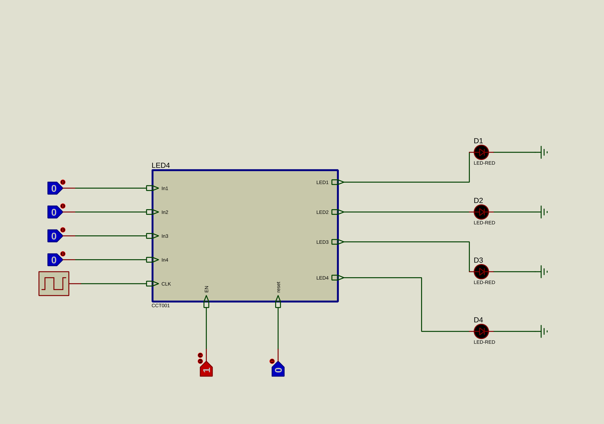

# Four-LED clocked circuit

This Proteus exercise has four logic inputs, a clock, enable/reset controls, and four LED outputs. The original project file is `DC2.pdsprj`.

Open the project in Proteus 8 Professional and use the run button to inspect the outputs. In the local review copy, simulation started without warnings or errors in the Proteus log. The complete behavior over all input combinations has not been verified.

