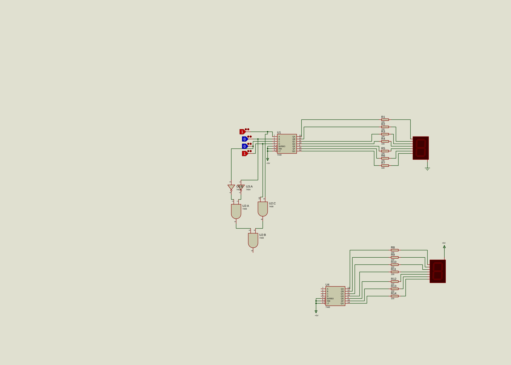

# Logic and seven-segment displays

This Proteus exercise combines logic gates with seven-segment display circuits. The original project file is `AZ_MANTEGHI.pdsprj`.

Open the project in Proteus 8 Professional and run the simulation. In the local review copy, simulation started without warnings or errors in the Proteus log. The complete truth table has not been checked.

