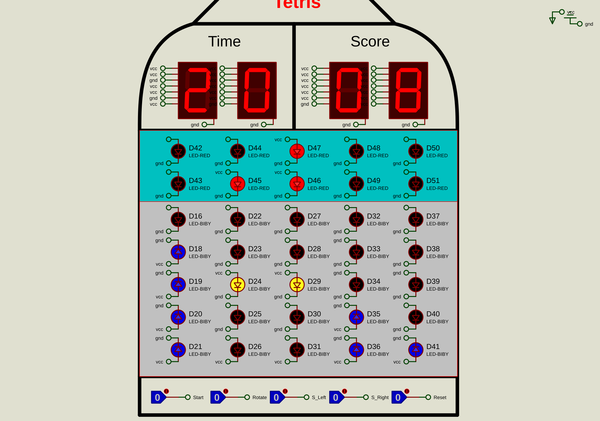

# Tetris display prototype

A Proteus schematic for a Tetris-style LED board, time and score display, and control inputs. The original project file is `DC_Project_RezaYaghoobi.pdsprj`.

This is presented as a **display and control-panel prototype**, not a complete playable Tetris game. The local review copy starts simulation without warnings or errors in the Proteus log. Game logic and end-to-end behavior have not been verified.

